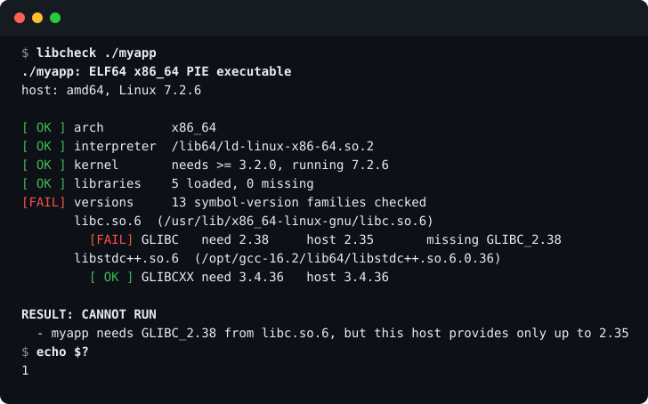

<div align="center">

# libcheck

**Will this Linux binary run on this machine? Get a straight answer.**

`libcheck` statically inspects an ELF program, resolves its shared libraries the way `ld.so` does,
and compares every required symbol version (`GLIBC_*`, `GLIBCXX_*`, `CXXABI_*`, ...) with what the
host really provides. It ends with one line: `CAN RUN` or `CANNOT RUN`, and tells you why.

[](https://github.com/DawnMagnet/libcheck/actions/workflows/ci.yml)
[](https://github.com/DawnMagnet/libcheck/releases/latest)
[](go.mod)
[](LICENSE)



</div>

## Why

The classic failure looks like this, and it only shows up on the target machine:

```text
./myapp: /lib/x86_64-linux-gnu/libc.so.6: version `GLIBC_2.38' not found (required by ./myapp)
```

You can find the cause with `readelf -V`, `objdump -T` and some `grep`, but then you still have to work
out which libraries the loader would pick, what versions *they* define, and whether the kernel is new
enough. `libcheck` does that whole comparison in one command, without running the program.

- **Answers the actual question.** Not "what does it need", but "will it run here".
- **Safe on untrusted files.** The program under test is only parsed, never executed (unlike `ldd`).
- **One static binary.** No Python, no binutils. Copy it to the machine you care about and run it.
- **Scriptable.** The exit code is the verdict, so it drops straight into CI and deploy scripts.

## Install

Download a static binary for your architecture (`amd64`, `arm64`, `armv7`, `386`, `riscv64`,
`ppc64le`, `s390x`, `loong64`):

```bash
arch=$(uname -m | sed 's/x86_64/amd64/; s/aarch64/arm64/; s/armv7l/armv7/; s/i[3-6]86/386/; s/loongarch64/loong64/')
curl -fsSL "https://github.com/DawnMagnet/libcheck/releases/latest/download/libcheck_linux_${arch}.tar.gz" |
  tar -xz libcheck
sudo install libcheck /usr/local/bin/
```

Or build it yourself (Go 1.24+):

```bash
go install github.com/DawnMagnet/libcheck@latest
```

Release archives ship with checksums, an SBOM and a signed build-provenance attestation, see
[Verifying downloads](#verifying-downloads).

## Usage

```bash
libcheck ./myapp                 # check one program
libcheck -v ./myapp              # also list every loaded library and every version family
libcheck -L ./vendor/lib ./myapp # add search directories, like LD_LIBRARY_PATH
libcheck bin/*                   # check several files, the exit code is the worst result
libcheck -version
```

| Exit code | Meaning |
|:---------:|---------|
| `0` | The program can run on this host |
| `1` | It cannot, the reasons are printed |
| `2` | Bad input: file missing, not an ELF, or corrupt |

Colors are used on a terminal; set `NO_COLOR=1` to turn them off or `FORCE_COLOR=1` to keep them in pipes.

### In CI or a deploy script

```bash
# Fail the pipeline when a build outgrows the oldest distro you support.
# libcheck is a static binary, so it runs inside any image.
docker run --rm \
  -v "$PWD/dist:/dist:ro" -v "$(command -v libcheck):/usr/local/bin/libcheck:ro" \
  debian:11 libcheck /dist/myapp
```

Or run it on the target host before you start the service.

## What it checks

| Check | How |
|-------|-----|
| **Architecture** | ELF machine and class against the host (`x86_64` hosts also accept 32-bit x86, `aarch64` hosts accept 32-bit ARM) |
| **Dynamic loader** | The `PT_INTERP` path, e.g. `/lib64/ld-linux-x86-64.so.2`, exists on the host |
| **Kernel** | The minimum kernel in `.note.ABI-tag` against the running kernel |
| **Libraries** | Every `DT_NEEDED` entry, recursively, resolved with the real search order |
| **Symbol versions** | Every `GLIBC_*`, `GLIBCXX_*`, `CXXABI_*`, `GCC_*`, ... requirement against the versions the resolved library defines |

Version names are compared as the loader does: by exact name. A requirement the library does not define is
a failure. A *weak* requirement the library does not define is reported as a warning, because the loader
tolerates it.

### Library search order

`libcheck` follows `ld.so`:

1. `DT_RPATH` of the object and its parents (only when it has no `DT_RUNPATH`)
2. `-L` directories and `LD_LIBRARY_PATH`
3. `DT_RUNPATH`
4. The `ld.so.cache` (`ldconfig -p`)
5. The default directories (`/lib64`, `/usr/lib64`, `/lib`, `/usr/lib`, plus `ld.so.conf` when there is no cache)

`$ORIGIN`, `$LIB` and `$PLATFORM` are expanded, and candidates for another architecture or class are skipped.

## How it compares

| Tool | What it gives you | What is left to you |
|------|-------------------|---------------------|
| `ldd` | Missing libraries and version errors as the loader reports them | It runs the loader on the file, so it is unsafe for untrusted binaries and only works on the target host. It shows no summary of what is required. |
| `readelf -V`, `objdump -T` | The raw version requirements | Resolving libraries, reading the host's versions, comparing, and the kernel |
| `auditwheel` | Checks Python wheels against `manylinux` policies | It targets wheels and a policy list, not your host |
| `linux-abi-scan` | Checks against a target's glibc and kernel floors | Compares with a declared floor, not with the libraries installed here |
| `libcheck` | One verdict for a given binary on a given host, with reasons | |

## Limitations

`libcheck` is a static check. It tells you when a program *will* fail to start. A pass means the loader's
requirements are met, not that the program is bug free.

- **No `dlopen`.** Libraries loaded at run time, plugins and data files are not examined.
- **Versioned symbols only.** The version check relies on GNU symbol versioning. Programs linked against
  musl have none, so for them only the architecture, loader, kernel and library checks apply. A missing
  *unversioned* symbol is not detected.
- **No CPU feature checks.** Instruction set requirements (for example `x86-64-v3`) are not examined.
- **Linux only.** It reads `/proc` and the system's linker configuration.
- It does not read `ld.so.preload` or `LD_PRELOAD`, and does not emulate `setuid` restrictions.

## Verifying downloads

Every release is built by [GitHub Actions](.github/workflows/release.yml) from the tagged commit. The
archives are accompanied by `checksums.txt`, SPDX SBOMs and a build-provenance attestation:

```bash
sha256sum --check --ignore-missing checksums.txt
gh attestation verify libcheck_linux_amd64.tar.gz --repo DawnMagnet/libcheck
```

## Development

```bash
go test -race ./...
go vet ./...
```

The tests build no fixtures: they patch copies of a binary found on the host (a missing library name, a
symbol version that does not exist) and check that `libcheck` flags them. Continuous integration runs the
tests on Ubuntu 22.04 and 24.04 (x86-64 and arm64) and on Alpine (musl), lints with `golangci-lint`, runs
`govulncheck` and dry-runs the release build on every pull request.

To publish a release, push a tag:

```bash
git tag v0.1.0 && git push origin v0.1.0
```

## License

[MIT](LICENSE)
