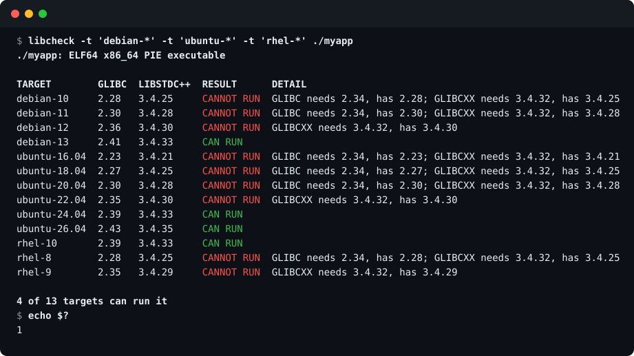

<div align="center">

# libcheck

**Will this Linux binary run there? Get a straight answer.**

`libcheck` statically inspects an ELF program, resolves its shared libraries the way `ld.so` does,
and compares every required symbol version (`GLIBC_*`, `GLIBCXX_*`, `CXXABI_*`, ...) with what the
system really provides. Check this machine, or any of **40+ built-in distributions** such as Debian,
Ubuntu, RHEL, Rocky, Fedora and Amazon Linux, without running anything.

[](https://github.com/DawnMagnet/libcheck/actions/workflows/ci.yml)
[](https://github.com/DawnMagnet/libcheck/releases/latest)
[](go.mod)
[](LICENSE)



</div>

## Why

The classic failure shows up only on the machine you deploy to:

```text
./myapp: /lib/x86_64-linux-gnu/libc.so.6: version `GLIBC_2.38' not found (required by ./myapp)
```

You can find the cause with `readelf -V`, `objdump -T` and some `grep`, but you still have to work out
which libraries the loader would pick, which versions *they* define, and whether the kernel is new
enough. And to know whether a build runs on Debian 11, RHEL 8 and Ubuntu 20.04 you would need all three
machines. `libcheck` does the whole comparison in one command.

- **Answers the actual question.** Not "what does it need", but "will it run there".
- **Any system, from anywhere.** Built-in profiles of 40+ distributions on amd64 and arm64, or record
  your own machine with `libcheck snapshot`. Works on Linux, macOS and Windows.
- **Safe on untrusted files.** The program under test is only parsed, never executed (unlike `ldd`).
- **One static binary.** No Python, no binutils. Copy it to any machine and run it.
- **Scriptable.** The exit code is the verdict, so it drops straight into CI and deploy scripts.

## Install

Download a static binary (Linux: `amd64`, `arm64`, `armv7`, `386`, `riscv64`, `ppc64le`, `s390x`,
`loong64`; macOS and Windows: `amd64`, `arm64`):

```bash
arch=$(uname -m | sed 's/x86_64/amd64/; s/aarch64/arm64/; s/armv7l/armv7/; s/i[3-6]86/386/; s/loongarch64/loong64/')
curl -fsSL "https://github.com/DawnMagnet/libcheck/releases/latest/download/libcheck_linux_${arch}.tar.gz" |
  tar -xz libcheck
sudo install libcheck /usr/local/bin/
```

Or build it yourself (Go 1.24+):

```bash
go install github.com/DawnMagnet/libcheck@latest
```

Release archives ship with checksums, an SBOM and a signed build-provenance attestation, see
[Verifying downloads](#verifying-downloads). Checking the machine you are on needs Linux; checking against
a built-in or recorded system (`-t`) works everywhere.

## Usage

### Check this machine

```bash
libcheck ./myapp                 # one program, full report
libcheck -v ./myapp              # also list every loaded library and every version family
libcheck -L ./vendor/lib ./myapp # add search directories, like LD_LIBRARY_PATH
libcheck bin/*                   # several files, the exit code is the worst result
```

<div align="center">

</div>

### Check another system

```bash
libcheck targets                           # list the built-in systems
libcheck -t debian-12 ./myapp              # one system, full report
libcheck -t 'ubuntu-*' -t rhel-8 ./myapp   # several systems, one table
libcheck -t all ./myapp                    # every built-in system
```

The architecture is taken from the binary, so an arm64 program is checked against the arm64 profiles.
Systems are named by id (`libcheck targets` shows them); globs such as `'ubuntu-*'` and the word `all`
work too.

| Family | Built-in systems |
|--------|------------------|
| Debian, Ubuntu | Debian 10 to 13, Ubuntu 16.04 to 26.04 LTS |
| Red Hat family | RHEL 8 to 10 (UBI), CentOS 7 and Stream 9 to 10, Rocky 8 to 10, AlmaLinux 8 to 10, Oracle Linux 7 to 10, Fedora 42 to 44 |
| Cloud and other | Amazon Linux 2 and 2023, Azure Linux 3, openSUSE Leap and Tumbleweed, SLES 15 (BCI), Photon OS 4 and 5, Arch, Wolfi, Alpine (musl) |

Profiles are generated from the official container images and refreshed weekly by
[a workflow](.github/workflows/profiles.yml); `libcheck targets` shows the snapshot date. A profile is a
*base image*: it contains what a fresh container has, not every package a real server might add. So a
missing library is not final. `libcheck` then says `CAN RUN AFTER INSTALLING libssl.so.3` and exits
with `3`. Missing symbol versions, such as a newer `GLIBC` than the distribution ships, are final.

### Check your own machine

Record the libraries of any system once, then check against it from anywhere:

```bash
# on the target machine (or inside its container)
libcheck snapshot -o prod.json.gz

# on your laptop or in CI
libcheck -t prod.json.gz ./myapp
```

A snapshot of a full system is treated as complete: a missing library is a failure. Other sources work as
well, for example an extracted root file system (`libcheck snapshot -root ./rootfs -id my-appliance`).
`libcheck snapshot -h` lists the options.

### Exit codes

| Exit code | Meaning |
|:---------:|---------|
| `0` | The program can run |
| `1` | It cannot, the reasons are printed |
| `2` | Bad input: file or target missing, not an ELF, or corrupt |
| `3` | It can run once extra libraries are installed (base-image targets only) |

With several files or targets the most severe result wins. Colors are used on a terminal; set `NO_COLOR=1`
to turn them off or `FORCE_COLOR=1` to keep them in pipes.

### In CI or a deploy script

```bash
# Fail the build when a binary outgrows the oldest systems you support
libcheck -t debian-11 -t rhel-8 -t ubuntu-20.04 dist/myapp
```

Or run it on the target host before you start the service.

## What it checks

| Check | How |
|-------|-----|
| **Architecture** | ELF machine and class against the host or target (`x86_64` hosts also accept 32-bit x86, `aarch64` hosts accept 32-bit ARM) |
| **Dynamic loader** | The `PT_INTERP` path, e.g. `/lib64/ld-linux-x86-64.so.2`, exists on the system |
| **Kernel** | The minimum kernel in `.note.ABI-tag` against the running kernel, or the kernel the target ships |
| **Libraries** | Every `DT_NEEDED` entry, recursively, resolved with the real search order |
| **Symbol versions** | Every `GLIBC_*`, `GLIBCXX_*`, `CXXABI_*`, `GCC_*`, ... requirement against the versions the resolved library defines |

Version names are compared as the loader does: by exact name. A requirement the library does not define is
a failure. A *weak* requirement the library does not define is reported as a warning, because the loader
tolerates it.

### Library search order

`libcheck` follows `ld.so`:

1. `DT_RPATH` of the object and its parents (only when it has no `DT_RUNPATH`)
2. `-L` directories and, when checking this host, `LD_LIBRARY_PATH`
3. `DT_RUNPATH`
4. The `ld.so.cache` (`ldconfig -p`) of this host, or the target's search directories
5. The default directories (`/lib64`, `/usr/lib64`, `/lib`, `/usr/lib`, plus those in `ld.so.conf`)

`$ORIGIN`, `$LIB` and `$PLATFORM` are expanded, and candidates for another architecture or class are skipped.
When checking a target, directories relative to the program (`$ORIGIN`) are read from your disk, so libraries
bundled next to the program are found; absolute directories are looked up in the target.

## How it compares

| Tool | What it gives you | What is left to you |
|------|-------------------|---------------------|
| `ldd` | Missing libraries and version errors as the loader reports them | It runs the loader on the file, so it is unsafe for untrusted binaries and only works on the target host. It shows no summary of what is required. |
| `readelf -V`, `objdump -T` | The raw version requirements | Resolving libraries, reading the target's versions, comparing, and the kernel |
| `auditwheel` | Checks Python wheels against `manylinux` policies | It targets wheels and a policy list, not a particular system |
| `linux-abi-scan` | Checks against a target's glibc and kernel floors | Compares with a declared floor, not with the libraries a system really ships |
| `libcheck` | One verdict for a binary on this host or on 40+ systems, with reasons | |

## Limitations

`libcheck` is a static check. It tells you when a program *will* fail to start. A pass means the loader's
requirements are met, not that the program is bug free.

- **No `dlopen`.** Libraries loaded at run time, plugins and data files are not examined.
- **Versioned symbols only.** The version check relies on GNU symbol versioning. Programs linked against
  musl have none, so for them only the architecture, loader, kernel and library checks apply. A missing
  *unversioned* symbol is not detected.
- **Base images.** Built-in profiles list what a fresh container contains. Libraries outside it are
  reported as "install more packages"; `libcheck` does not know which package provides them.
- **Kernels.** For built-in targets the kernel is the distribution's default; newer ones may be installed,
  so a too-old kernel is only a warning there.
- **No CPU feature checks.** Instruction set requirements (for example `x86-64-v3`) are not examined.
- It does not read `ld.so.preload` or `LD_PRELOAD`, and does not emulate `setuid` restrictions.

## Verifying downloads

Every release is built by [GitHub Actions](.github/workflows/release.yml) from the tagged commit. The
archives are accompanied by `checksums.txt`, SPDX SBOMs and a build-provenance attestation:

```bash
sha256sum --check --ignore-missing checksums.txt
gh attestation verify libcheck_linux_amd64.tar.gz --repo DawnMagnet/libcheck
```

## Development

```bash
go test -race ./...
go vet ./...
go run . targets
```

The tests build no fixtures: they patch copies of a binary found on the host (a missing library name, a
symbol version that does not exist) and check that `libcheck` flags them, and they snapshot the host to
exercise target mode. Continuous integration runs the tests on Ubuntu 22.04 and 24.04 (x86-64 and arm64),
Alpine (musl), macOS and Windows, lints with `golangci-lint`, runs `govulncheck` and dry-runs the release
build on every pull request.

To add a distribution, append it to [`profiles/sources.json`](profiles/sources.json); the profiles
workflow does the rest. To publish a release, push a tag:

```bash
git tag v0.2.0 && git push origin v0.2.0
```

## License

[MIT](LICENSE)
